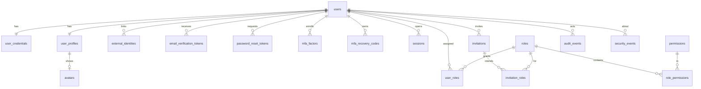

# 07 — Data Model / ERD (Phase 3)

> **Update (ADR-013):** the backend is now **ASP.NET Core (.NET)**, not Next.js/TypeScript. Where this document mentions Next.js route handlers, Server Actions, Drizzle, zod or Vercel for the API, read the equivalent in `13-adr-dotnet-backend.md`. Design intent (layers, schema, contracts, security controls) is unchanged.

Status: **proposed — awaiting PO approval.** PostgreSQL 16 + Drizzle. Single-tenant (D-06): there is deliberately **no `org_id`**. Names are `snake_case`; PKs are `uuid` (v7 where ordering helps) unless noted; all timestamps `timestamptz` (UTC).

> **Implementation notes (slice 1):** implemented as EF Core 10 migrations (`api/src/AnnabaDigital.Infrastructure/Persistence/Migrations`). `citext` → `text` + `CHECK (email = lower(email))` + unique index; `inet` → `text`; token/session hashes are SHA-256 **hex text**; enums stored as strings; append-only `audit_events` is enforced by **DB triggers** (UPDATE/DELETE/TRUNCATE rejected; retention purge only inside `SET LOCAL annabadigital.allow_audit_purge = 'on'`). Tables for later slices (invitations, MFA, tokens, avatars, external identities) already exist but have no endpoints yet.

## 1. ERD


## 2. Tables
Legend: **PK**, **FK**, `UQ` unique, `IDX` index, `CK` check.

### 2.1 Identity
**users**
| column | type | notes |
|---|---|---|
| id | uuid PK | |
| email | citext NOT NULL | `UQ` (case-insensitive) |
| name | text NOT NULL | `CK length(trim(name)) >= 2` |
| status | user_status NOT NULL default `pending` | enum below |
| email_verified_at | timestamptz null | null ⇒ unverified |
| failed_login_count | int NOT NULL default 0 | reset on success |
| locked_until | timestamptz null | temporary lock (status stays `active`; `locked` is derived when `locked_until > now()`) |
| last_login_at | timestamptz null | |
| created_at / updated_at | timestamptz | |
| deactivated_at | timestamptz null | |
| version | int NOT NULL default 1 | optimistic concurrency |
IDX: `(status)`, `(created_at desc)`, `(lower(name) text_pattern_ops)` for search, `(last_login_at)`.

**user_credentials** — `user_id` PK/FK, `password_hash` text NOT NULL (Argon2id PHC string incl. params), `password_changed_at`, `must_change` bool. Separate table so ordinary user queries never load hashes.

**user_profiles** — `user_id` PK/FK, `phone`, `department`, `job_title`, `language` (`en|id`), `timezone`, `notify_email`, `notify_security`, `notify_product` (bool), `auto_lock_minutes` int, `avatar_id` FK → avatars null.

**avatars** — `id`, `user_id` UQ FK, `content_type` CK in (png,jpeg,webp), `bytes` bytea CK `octet_length <= 262144`, `created_at`. (Adapter allows swap to S3/Blob later — D-11.)

**external_identities** *(extension point)* — `id`, `user_id` FK, `provider`, `subject`, `created_at`; `UQ(provider, subject)`.

### 2.2 Tokens & MFA
All token tables store **only `token_hash` (SHA-256 of a 256-bit random token)**; the raw token exists only in the email link.

**email_verification_tokens** — `id`, `user_id` FK, `new_email` citext null (set for email-change), `token_hash` UQ, `expires_at`, `consumed_at`, `created_at`. IDX `(user_id, created_at desc)`. Creating a new token invalidates (`consumed_at=now()`) earlier unconsumed ones.

**password_reset_tokens** — `id`, `user_id` FK, `token_hash` UQ, `expires_at` (30 min), `consumed_at`, `request_ip` inet, `created_at`. Single-use: consumption is `UPDATE … SET consumed_at=now() WHERE token_hash=$1 AND consumed_at IS NULL AND expires_at>now() RETURNING user_id` (atomic).

**mfa_factors** — `id`, `user_id` FK, `type` (`totp` | future `webauthn`), `secret_ciphertext` bytea, `secret_nonce` bytea, `key_version` int, `confirmed_at` null (null while enrolling), `last_used_step` bigint (replay protection), `created_at`. `UQ(user_id, type)`. Secret encrypted with AES-256-GCM using `ENCRYPTION_KEY[key_version]`.

**mfa_recovery_codes** — `id`, `user_id` FK, `code_hash` (Argon2id or SHA-256 of high-entropy code), `used_at`, `created_at`. 10 per set; regenerate = delete all + insert new in one transaction.

### 2.3 RBAC
**permissions** — `key` text PK (`resource.action`, `CK key ~ '^[a-z_]+\.[a-z_]+$'`), `module`, `description`, `is_critical` bool. **Seeded from code** (single source of truth); not editable at runtime.

**roles** — `id` uuid PK, `key` text `UQ` (stable id like `super_admin`), `name` text, `description`, `is_system` bool, `is_protected` bool, `archived_at` null, timestamps. `UQ(lower(name)) WHERE archived_at IS NULL`.

**role_permissions** — `role_id` FK, `permission_key` FK, `granted_by` FK users, `granted_at`; PK `(role_id, permission_key)`.

**user_roles** — `user_id` FK, `role_id` FK, `assigned_by` FK, `assigned_at`; PK `(user_id, role_id)`. IDX `(role_id)`.

Effective permissions for a user:
```sql
SELECT DISTINCT rp.permission_key
FROM user_roles ur
JOIN roles r ON r.id = ur.role_id AND r.archived_at IS NULL
JOIN role_permissions rp ON rp.role_id = r.id
JOIN users u ON u.id = ur.user_id AND u.status = 'active'
WHERE ur.user_id = $1;
```

### 2.4 Sessions & invitations
**sessions** — `id` uuid PK, `token_hash` bytea `UQ` (hash of 256-bit random id; raw value only in the cookie), `user_id` FK, `created_at`, `last_active_at`, `idle_expires_at`, `absolute_expires_at`, `revoked_at`, `revoked_reason` (`user|admin|password_reset|suspended|expired`), `locked_at` null (**server-side lock**), `mfa_verified_at`, `reauth_at` (for sensitive actions), `ip` inet, `user_agent` text, `device_label`, `browser_label`. IDX `(user_id) WHERE revoked_at IS NULL`, `(absolute_expires_at)`.
A session is **valid** iff `revoked_at IS NULL AND now() < idle_expires_at AND now() < absolute_expires_at`; **usable** additionally requires `locked_at IS NULL` and user `active`.

**invitations** — `id`, `email` citext, `token_hash` UQ, `invited_by` FK, `message` text null, `status` (`pending|accepted|revoked`; *expired* is derived from `expires_at`), `expires_at`, `accepted_at`, `accepted_user_id` FK null, `revoked_at`, `created_at`. **Partial unique** `UQ(email) WHERE status='pending'` (one open invitation per address). **invitation_roles** — `(invitation_id, role_id)` PK.

### 2.5 Monitoring & settings
**audit_events** — `id` bigserial PK, `ts` timestamptz default now(), `actor_id` FK null (system/anonymous), `actor_label` text (snapshot name/email for deleted/anonymous actors), `action` text, `target_type`, `target_id`, `outcome` (`success|failure|denied`), `ip` inet, `user_agent`, `request_id`, `meta` jsonb (redacted), `diff` jsonb (safe before/after). IDX `(ts desc)`, `(actor_id, ts desc)`, `(action, ts desc)`, `(target_type, target_id)`. **Append-only**: the application DB role has `INSERT, SELECT` only; purge runs under a separate maintenance role.

**security_events** — `id`, `ts`, `type`, `severity` (`low|medium|high`), `user_id` FK null, `detail` text, `meta` jsonb, `acknowledged_by` FK null, `acknowledged_at`. IDX `(ts desc)`, `(acknowledged_at) WHERE acknowledged_at IS NULL`, `(user_id, ts desc)`.

**system_settings** — `key` text PK, `value` jsonb, `is_secret` bool, `value_ciphertext` bytea null (for secrets; `value` null), `key_version`, `updated_by` FK, `updated_at`, `version`. Secrets are never selected by read endpoints (API returns `{set: true}` only).

**rate_limit_buckets** — `key` text PK (`scope:ip:…` / `scope:acct:…`), `count` int, `window_start` timestamptz, `blocked_until` timestamptz null. Cleanup by cron.

*(P2)* `daily_auth_stats(date PK, success int, failure int)` rollup for the dashboard if audit volume makes live aggregation slow.

## 3. Enums & state machines
```
user_status:  pending ──verify──▶ active ◀──activate── suspended
                │                   │ ▲                   ▲
                │                   │ └──activate── deactivated
                └──(admin) deactivate/suspend──────────────┘
 active ──suspend──▶ suspended ──deactivate──▶ deactivated        (temp lock = locked_until, not a status)
invitation:   pending ──accept──▶ accepted
              pending ──revoke──▶ revoked        pending ──(time)──▶ expired(derived)
              resend: pending/expired/revoked ──▶ pending (new token_hash, new expiry)
session:      active ──lock──▶ locked ──unlock──▶ active
              active|locked ──revoke/expire──▶ ended
```
Transitions are enforced in `domain` (table of allowed moves) and re-validated in the use-case transaction.

## 4. Integrity rules beyond FKs
| Rule | Mechanism |
|---|---|
| ≥ 1 active Super Admin always | use-case check under `FOR UPDATE` **plus** a deferred constraint trigger on `user_roles`/`users` as a backstop |
| Protected roles' permissions immutable | domain policy + trigger rejecting `role_permissions` changes where `roles.is_protected` |
| Cannot grant a permission you lack | use-case (`grantableRoles`, matrix-save check); audited as `denied` |
| One pending invitation per email | partial unique index |
| Token single use | atomic `UPDATE … RETURNING` |
| MFA TOTP replay | `last_used_step` must increase |
| Email uniqueness incl. pending email change | change confirmed only if address still unused at confirmation time |
| Audit immutability | DB grants (no UPDATE/DELETE for app role) |

## 5. Seed data (migration `0002_seed`)
Permission catalog (17 keys, see RBAC matrix) · roles `super_admin` (protected, all permissions), `user_admin`, `security_auditor`, `user` · default `system_settings` (invitation-only, 12-char min, idle 30 min, absolute 12 h, lockout 5/15 min, MFA optional, invitations 7 d, audit retention 365 d) · **no default users**. First Super Admin is created by `npm run bootstrap:admin` (reads email from env, emails a one-time setup link — never a default password).

## 6. Retention & cleanup (cron, daily)
The helpdesk's own data (finished tickets, files, notifications) is governed per organisation by `retention_policies`, off until an administrator switches it on — see `36-ga-helpdesk-slice13-report.md`. The rules below are the platform's housekeeping.
Delete consumed/expired tokens older than 7 days · delete revoked/expired sessions older than 30 days · purge `audit_events`/`security_events` older than `auditRetentionDays` (maintenance role, itself audited) · prune `rate_limit_buckets`.

## 7. Sizing & performance notes
10k users / 1M audit rows: all list endpoints are keyset- or offset-paginated on indexed columns; search uses trigram index (`pg_trgm`) on `name`/`email` if `ILIKE '%x%'` is required (decision with the users-list implementation). Dashboard aggregates use indexed counts; heavy login-activity charts use `daily_auth_stats` if p95 > 300 ms.

## 8. GA Helpdesk additions (R1 slices 1–2; see `23`, `24`, `25`)
Every table below is tenant-scoped: `tenant_id` FK → `tenants`, EF global query filter, tenant stamped on save, tenant-leading indexes. "Live" = `archived_at IS NULL`. `version` is an optimistic-concurrency token on every editable table.

| Table | Purpose | Key constraints |
|---|---|---|
| `locations` | Region → site → building → floor → room tree | parent FK (restrict); `parent_id <> id`; unique `(tenant_id, code)` among live; type depth enforced in the service (a child is always deeper than its parent) |
| `business_calendars` | Working windows for SLA clocks | unique `(tenant_id, name)` among live; **one default per tenant** (partial unique index on `is_default AND archived_at IS NULL`) |
| `calendar_periods` | Weekly windows (minutes from midnight) | `0 ≤ start < end ≤ 1440`; `day` 0–6; overlap rejected in the service |
| `calendar_holidays` | Holiday dates | unique `(calendar_id, date)` |
| `teams`, `team_members` | Agent groups | unique `(tenant_id, name)` among live; member PK `(team_id, user_id)` |
| `service_categories` | Catalog categories, two levels | `parent_id <> id`; unique name among live siblings (two partial indexes: roots, and `(tenant_id, parent_id, name)`) |
| `services` | Things people can request | unique `(tenant_id, category_id, name)` among live; `current_form_version ≥ 0`; `is_published`; priority and audience stored as text |
| `service_form_versions` | **Immutable** form snapshots (`fields_json` jsonb) | unique `(service_id, number)`, `number ≥ 1`; cascade with the service; creator FK set-null |
| `tickets` | One request (slice 3) | unique `(tenant_id, number)` and `(tenant_id, year, sequence)`; service name, form version and `answers_json` (jsonb) are snapshots; status/priority stored as text; requester/creator FK restrict, assignee/team/location FK set-null; indexes on `(tenant, status, updated_at)`, `(tenant, requester, updated_at)`, `(tenant, assignee)`, `(tenant, team)` |
| `ticket_events` | Append-only timeline (created, comment, status, assigned, updated); `internal` rows hidden from requesters; `actor_label` keeps the name at the time | index `(ticket_id, created_at)`; cascade with the ticket |
| `ticket_counters` | Last sequence per `(tenant_id, year)` | incremented only by `INSERT … ON CONFLICT DO UPDATE … RETURNING` inside the ticket's transaction |
| `sla_policies` | SLA policy (slice 4): optional conditions (service, category, place, priority), optional calendar, first-response and resolution targets in working minutes, two escalation percentages | unique name among live; `position` orders matching; checks `resolution ≥ first_response ≥ 1` and `1 ≤ escalate1percent < escalate2percent ≤ 99`; conditions FK restrict |
| `assignment_rules` | Routing rule (slice 4): optional conditions as above, required team, strategy (`None`/`RoundRobin`/`LeastLoaded`) | unique name among live; `position` orders matching; team FK restrict (a team with live rules can't be archived) |
| `approval_policies` | Approval policy of a service (slice 5): `steps_json` (jsonb: ordered steps with name, rule `any`/`all`, user ids, role ids), optional fallback user | one live policy per service (partial unique index); service FK restrict |
| `ticket_approvals` | One person's decision on one ticket at one step; **immutable once decided** (decision, comment, time, `decided_via` app/email, ip, device); `token_hash` of the one-time link (cleared on decision) | unique `(ticket_id, step_no, approver_id)`; unique `token_hash` when set; ticket cascade |
| `attachments` | A file on a ticket (slice 7): name, content type (from our allow-list), size (`> 0`), SHA-256, generated `storage_key` (`{tenant}/{id}`, bytes live outside the DB behind `IFileStorage`), uploader, `deleted_at` (soft delete; bytes removed) | `ticket_id` NULL = uploaded for a form not yet submitted (purged after 24 h); ticket cascade, uploader restrict; indexes `(tenant_id, ticket_id)` and a partial one on unclaimed rows |
| `ticket_views` | A saved queue filter (slice 9): name, `filter_json` (text: a small map of the queue's filter names), `shared`, owner | unique `(tenant_id, owner_id, name)`; index `(tenant_id, shared)`; cascades with the owner |
| `approval_delegations` | Out-of-office cover (slice 10): delegator `user_id`, `delegate_id`, `starts_at`, `ends_at`, note, `revoked_at` | checks `ends_at > starts_at` and `user_id <> delegate_id`; indexes `(tenant_id, user_id, starts_at)` and `(tenant_id, delegate_id)`; cascade with either user |
| `notification_preferences` | One person's choice for one kind of notification (slice 11): `kind`, `in_app` and `email` as nullable booleans (`null` = as usual, so only differences from the default are stored) | unique `(tenant_id, user_id, kind)`; cascades with the user |
| `notifications` | In-app message for one user (`kind`, title, body, link, optional ticket, `read_at`) | index `(tenant, user, read_at, created_at)`; cascades with the user and the ticket |

**Work orders (R2 slice 3, migration `WorkOrders`):** `work_orders` (per ticket `seq` unique with `ticket_id`, `number` = `<ticket>-W<seq>`, title, instructions, assignee, team, asset, `required`, `require_after_photo`, status text open/in_progress/on_hold/done/cancelled, hold/cancel reasons, completion note, due/started/completed times, version), `work_order_tasks` (checklist lines with done-by), `work_order_times` (minutes 1–1440 per line, work date), `work_order_costs` (kind, description, quantity numeric(12,2) > 0, unit cost numeric(15,2) ≥ 0), `checklist_templates` (name unique among active, `items_json` jsonb), `tickets.resolve_with_work_orders`, and `attachments.work_order_id` + `stage` (before/after).

**Vendors (R2 slice 4, migration `Vendors`):** `vendors` (name 2–150, services, e-mail, phone, website, address, tax number, notes, `blocked_at` + `block_reason`, version), `vendor_contacts` (position-ordered, ≤ 20 per vendor, cascade), `vendor_sites` (PK `vendor_id` + `location_id`: the places a vendor covers; a place includes the places below it), `vendor_contracts` (title, reference, `starts_on`, `ends_on` (null = open-ended), `value` numeric(15,2), notes, `expiry_notice` 0/1/2 for the reminder), `vendor_documents` (stored file metadata, optional `contract_id`, soft delete, ≤ 50 per vendor), and `work_orders.vendor_id` (FK, indexed) + `purchase_order` (≤ 50).

**Preventive maintenance (R2 slice 5, migration `Maintenance`):** `maintenance_plans` (name unique per organisation, instructions, `service_id`, target = `asset_id`, or `asset_type_id` with an optional `location_id` (that place and below), or `location_id` alone — at least one, checked; `unit` text day/week/month/year, `every` ≥ 1, `starts_on`, `ends_on` ≥ start, `lead_days` 0–90, `next_index` + `next_due_on` (null once ended; partial index on active plans), checklist template, team, person, vendor, `require_after_photo`, `paused_at`, `owner_id`, version) and `maintenance_visits` (plan, `target_key` = asset or place id, asset, place, `due_on`, ticket, work order, `missed`; **unique `(plan_id, target_key, due_on)`** so a visit is never made twice).

**Satisfaction (R2 slice 6, migration `Ratings`):** `ticket_ratings` (one per ticket, unique `ticket_id`, `score` 1–5 checked, comment ≤ 1000, rater, and the assignee, team and place of the ticket when rated, `alerted_at` for the once-only low-score alert; indexes on `(tenant_id, updated_at)` and `(tenant_id, assignee_id, updated_at)`).

**Knowledge base (R2 slice 7, migration `KnowledgeBase`):** `kb_categories` (name unique among active), `kb_articles` (category, `visibility` everyone/staff, `status` draft/published/archived, the **published** title, summary and body (what readers see and search), `published_version`, `latest_version`, `review_by`, `views`, `deflections`, version), `kb_article_versions` (unique `(article_id, number)`, title, summary, Markdown body ≤ 50,000, note, author — never changed), `kb_article_services` (PK article + service), `kb_feedback` (PK article + user, helpful yes/no) and `kb_files` (stored file metadata, soft delete, ≤ 20 per article).

**Cost and budget (R2 slice 8, migration `CostAndBudget`):** `cost_settings` (one row per organisation: `currency` ISO code, `labour_rate_per_hour` numeric(15,2) ≥ 0 or null), `cost_centers` (code unique per organisation, name, archived, version), `cost_center_places` (PK `location_id`: a place belongs to at most one cost centre), `budgets` (`scope` cost_center/site/category, `scope_id`, `year` 2000–2100, `amount` numeric(15,2) > 0, note, `alert_level` 0/1/2; unique `(tenant, scope, scope_id, year)`). Work-order cost kinds gain `invoice`. All money is `numeric` with two decimals; computed amounts are rounded half away from zero per line.

**E-mail to ticket (R2 slice 9, migration `InboundEmail`):** `inbound_mailboxes` (one per organisation: `address`, `default_service_id`, `enabled`, `token_hash` = SHA-256 of the webhook token (unique), `token_hint`, version) and `inbound_messages` (mailbox, `message_id` (unique per mailbox), sender, subject, size, `outcome` created/replied/ignored/rejected, reason, ticket, user, `received_at`).

**API keys and webhooks (R2 slice 10, migration `Integrations`):** `api_keys` (name, `token_hash` SHA-256 (unique), `prefix`, `scopes`, `user_id` (the person the key acts as), expiry, last use, revocation), `api_idempotency` (PK key + Idempotency-Key → ticket), `webhook_endpoints` (url, description, `events`, enabled, the signing secret encrypted with AES-GCM (`secret_ciphertext` = nonce + ciphertext, `secret_key_version`), version) and `webhook_deliveries` (the outbox: endpoint, `event_id`, event, `payload_json` jsonb, attempts, next attempt, delivered/failed, last status and error; partial index on pending rows).

**Vendor portal (R2 slice 11, migration `VendorPortal`):** `vendor_users` (PK `user_id` — one vendor per person — `vendor_id`, who linked them and when; cascades with the user and the vendor). The seeded system role `vendor` holds `workorders.read` and `workorders.complete`.

**Bookings (R3 slice 1, migration `Bookings`):**
- `bookable_resources`: `kind` (room, vehicle, parking, equipment), `name`, `code` (upper case, unique per organisation when set), `description`, `location_id` (restrict), `capacity`, `features text[]` (lower-case tags), `open_from`/`open_until time` (both or neither; neither = around the clock; until after from), `open_days` (bit mask, Monday = bit 0, 1–127), `buffer_minutes` (0–240), `max_minutes`, `needs_approval` (used from R3-2), `allowed_role_ids uuid[]` (empty = everyone who may book), `archived_at`, `version`.
- `bookings`: `resource_id` (restrict), `title`, `booked_for_id`, `created_by_id`, `starts_at`, `ends_at`, `blocked_until` (end plus the resource's buffer at booking time), `attendees`, `note`, `status` (Confirmed, Cancelled), `cancelled_at`/`cancelled_by_id`/`cancel_reason`, `version`. Check: `ends_at > starts_at AND blocked_until >= ends_at`.
- **No double booking:** `ex_bookings_no_overlap EXCLUDE USING gist (tenant_id WITH =, resource_id WITH =, tstzrange(starts_at, blocked_until, '[)') WITH &&) WHERE (status = 'Confirmed')`, with the `btree_gist` extension (trusted, created by the migration). A booking may start exactly when the previous one's buffer ends.
- Times are UTC; opening hours and days are checked in the resource's place time zone (the nearest place up the tree with one), else the default calendar's.

**Booking lifecycle (R3 slice 2, migration `BookingLifecycle`):**
- `bookable_resources.check_in_minutes` (10, 15, 20, 30 or 60; empty = no check-in).
- `bookings` gains `series_id` and `repeat` (day, weekday, week) for repeating bookings, `checked_in_at`, `reminded_at`, `decided_by_id`, `decided_at` and `decision_note`. `status` adds Pending, Rejected and Released (nobody checked in).
- The no-overlap constraint now covers `status IN ('Confirmed', 'Pending')`: a booking waiting for approval holds its slot.
- `booking_feeds`: one row per person (PK `user_id`, cascades with the user): `token_hash` (SHA-256, unique), `created_at`, `last_read_at`. The token itself is shown once and never stored.

**Vehicles (R3 slice 3, migration `Vehicles`):**
- `vehicle_trips`: one per booking (PK `booking_id`, cascades with it; `resource_id` restrict).
  - Who and where: `driver_id` (empty = the person it is booked for), `needs_driver`, `destination`, `purpose`.
  - Pick-up and return: `odometer_out`, `picked_up_at`/`_by_id`, `odometer_in`, `returned_at`/`_by_id`.
  - Costs: `fuel_cost`, `toll_cost`, `parking_cost` (14,2).
  - Condition: `damage_notes`, `checklist_json` (jsonb).
  - Checks: odometer in ≥ out, costs ≥ 0.
- `resource_documents`: `resource_id` (cascade), `kind` (Registration = STNK, Insurance, Inspection = KIR, Service, Other), `number`, `expires_on`, `note`, `reminded` (soon, expired; reset when the date changes).
- `driver_licences`: one per person (PK `user_id`, cascades), `number`, `class`, `expires_on`, `reminded`.

**Visitors (R3 slice 4, migration `Visitors`):**
- `visits`:
  - Visitor: `visitor_name`, `company`, `email`, `phone`, `vehicle_plate`.
  - Visit: `host_id`, `location_id` (restrict), `purpose`, `expected_from`/`expected_until` (check: until > from).
  - Reception: `status` (Expected, CheckedIn, CheckedOut, Cancelled, NoShow), `flag` (block-list reason), `badge_number` (unique per organisation among visitors checked in), `id_last4`, `acknowledged_at`, `checked_in_at`/`_by_id`, `checked_out_at`/`_by_id`.
  - Record keeping: `created_by_id`, `anonymised_at`, `version`.
- `visitor_blocks`: `name`, `company` (optional), `reason`, `created_by_id`, `removed_at`.
- `visitor_settings`: one row per organisation (PK `tenant_id`): `acknowledgement`, `ask_id_last4`, `retention_days` (default 180).
- Retention: after `retention_days`, a finished visit keeps its status and times but loses name (becomes "Visitor"), company, contact, plate, purpose, badge, ID digits and flag.

**Mail and courier (R3 slice 5, migration `Mail`):**
- `mail_items` holds one row per letter or parcel.
  - **What it is:** `direction` (Incoming, Outgoing), `kind` (Letter, Document, Parcel, Other).
  - **Status:** Received, Collected, Registered, Sent, Voided. Incoming items go Received → Collected; outgoing items go Registered → Sent.
  - **Who:** `person_id` (the employee it is for, or who sends it) and `other_party` (the sender outside, or the addressee). Outgoing items also have an `address`.
  - **Delivery:** `carrier`, `waybill`, `description`, `location_id` (the mailroom).
  - **Logging:** `logged_at`/`_by_id`, `reminded_at`.
  - **Closing:** `done_at`/`_by_id` (collected or sent), `collected_by` (a name), `note`.
  - **Retention:** `anonymised_at`. Items use the visitor retention period.

**Inventory (R3 slice 6, migration `Inventory`):**
- `inventory_items`: `sku` (unique per organisation, upper case), `name`, `category` (atk, pantry, cleaning, uniform, toiletries, it, other), `unit`, `reorder_level` (≥ 0), `reorder_quantity`, `unit_cost` (14,2; the last receipt's), `description`, `archived_at`, `version`.
- `stock_balances` (PK `item_id` + `location_id`): `quantity`, with check `quantity >= 0`, and `low_notified_at`. A cache of the ledger, changed in the same transaction as each movement by an atomic `quantity = quantity + Δ WHERE quantity + Δ >= 0`.
- `stock_movements` is the append-only ledger:
  - what moved: `item_id`, `location_id`, `kind` (Receipt, Issue, Adjustment, TransferOut, TransferIn, Count), signed `quantity` (never 0);
  - the result: `balance_after`;
  - context: `unit_cost`, `reference`, `group_id` (both halves of a transfer; the stock-take), `by_id`, `at`.
- `stock_takes` (one open per place: a filtered unique index) and `stock_take_lines` (PK `stock_take_id` + `item_id`): `expected` frozen at start, `counted`.

**Supply requests (R3 slice 7, migration `SuppliesAndReports`):**
- `supply_requests`: `number` (unique per organisation, `SR-yyyy-nnnn`), `requester_id`, `location_id` (the stock place), `note`, `status` (Pending, Open, PartlyFulfilled, Fulfilled, Rejected, Cancelled, Closed), `estimated_cost` (14,2), `approver_id` (the requester's manager when approval is needed), `decided_by_id`, `decided_at`, `decision_note`, `fulfilled_at`, `version`.
- `supply_request_lines` (PK `request_id` + `item_id`): `quantity`, `issued` (check `0 ≤ issued ≤ quantity`; the back-order is the difference), `unit_cost` when asked.
- `supply_settings` (one row per organisation): `approval_above` (empty: never), `default_location_id`.
- Issues are ordinary `stock_movements` (kind Issue) with `group_id` = the request id.
- `work_order_costs` gains `stock_item_id`, `stock_location_id`, `stock_quantity` for a part drawn from stock (INV-005); its movements carry `group_id` = the work order id.

**Scheduled reports (R3 slice 8, same migration):**
- `report_schedules`: `owner_id`, `name`, `report` (tickets, sla, csat, costs, compliance, utilisation, inventory), `format` (csv, xlsx), `frequency` (daily, weekly, monthly), `weekday` (1–7), `month_day` (1–28), `hour` (0–23, organisation time zone), `days` (1–365), `recipient_ids` (uuid[]), `active`, `next_run_at` (indexed where active), `last_run_at`, `last_result`, `version`.
- `outbox_emails` gains `attachment_name`, `attachment_type` and `attachment_content` (bytea, cleared with the body once sent or given up).

**Directory (R3 slice 9, migration `Directory`):**
- `directory_group_mappings`: `group` (≤ 200, unique with `role_id` per organisation), `role_id` (cascade), `created_by_id`, `created_at`.
- `scim_groups`: `display_name` (unique per organisation), `external_id`, `member_ids` (uuid[], GIN index), `created_at`, `updated_at`.
- `user_profiles` gains `employee_id` (≤ 50), `site_id` (→ locations, set null) and `external_id` (≤ 200, the identity provider's id; indexed).

**Notification channels and field mode (R3 slices 10 and 11, migration `ChannelsAndFieldMode`):**
- `channel_settings` (one per organisation and kind: whatsapp, slack, teams): `enabled`, `settings_json` (public settings), `secret_ciphertext`, `secret_nonce` and `secret_key_version` (credentials, AES-GCM bound to the row), `updated_by_id`, `updated_at`.
- `user_channels` (unique per person and kind): `address_ciphertext`, `address_nonce`, `address_key_version` (phone, Slack member ID or Teams URL, encrypted), `hint`, `enabled`, `replace_email`, `verified_at`, `code_hash` (keyed hash), `code_expires_at`, `code_attempts`, `last_error`.
- `channel_deliveries` (the outbox):
  - what to send: `group_id` (all channels of one notification), `user_id`, `channel`, `purpose` (notify, verify, test), `notification_kind`, `title` and `body` (cleared once delivered or failed), `link`, `replaces_email`;
  - progress: `attempts`, `next_attempt_at` (indexed while due), `delivered_at`, `failed_at`, `last_error`, `fell_back_at`;
  - kept 30 days.
- `offline_ops` (PK `user_id` + `key`): the `Idempotency-Key` of each replayed work-order change (`created_at`, kept 7 days).

**Asset register (R2 slice 1, migration `AssetRegister`):** `asset_types` (name unique per organisation among active types, `fields_json` jsonb = form definition, archived_at, version), `assets` (`tag` unique per organisation, upper case; `asset_type_id`, `serial`, `status` text in_use/in_repair/stored/retired, `location_id`, `assigned_to_id`, `department`, `purchase_date` date, `purchase_cost` numeric(15,2) ≥ 0, `warranty_end` date, `vendor_name`, `notes`, `fields_json` jsonb, `retired_at`, `retire_reason`, version; indexes by type, place, person and a partial one on warranty end of assets in service), `asset_events` (append-only trail: created/updated/moved/assigned/status/retired/restored with actor label), `asset_counters` (one row per organisation, atomic upsert for automatic tags) and `tickets.asset_id` (indexed where set). R2-2 (migration `AssetWarrantyNotice`): `assets.warranty_notice` (0 none, 1 "ends within 30 days" sent, 2 "has ended" sent; reset when the warranty end changes).

**E-mail wording (slice 16, migration `EmailWording`):** `email_wordings` (one row per organisation, unique `tenant_id`: `sender_name` ≤ 60, `subject_prefix` ≤ 30, `footer_en` / `footer_id` ≤ 400, `updated_at`, `updated_by`). Read by the outbox when a message is queued.

**Data retention (slice 13, migration `DataRetention`):** `retention_policies` (one row per organisation, unique `tenant_id`: `enabled`, `finished_ticket_days`, `ticket_action` `anonymise|delete`, `attachment_days`, `notification_days`, `last_run_at`, `last_run_json`; check constraints keep the periods in range), `ticket_legal_holds` (unique `ticket_id`, `reason`, `placed_by_id`, `placed_at`; cascades with the ticket) and `tickets.anonymised_at` (set once the content was removed; such a ticket cannot change any more).

**Indexes added for scale (slice 12)** on `tickets`: `ix_tickets_tenant_id_open_updated_at` (partial: not closed/cancelled/rejected, newest first), `ix_tickets_tenant_id_updated_at`, `ix_tickets_open_due` (partial, deadline order), `ix_tickets_created`, `ix_tickets_resolved` (partial), `ix_tickets_breached` (partial), and three **trigram GIN** indexes on `lower(number)`, `lower(subject)`, `lower(description)` (extension `pg_trgm`); on `notifications`: `ix_notifications_user_newest`. The expression and trigram indexes are created by SQL in migration `SearchAndQueueIndexes`.

`ticket_approvals` carries `on_behalf_of_id` (slice 10: the person an approval was originally for, when someone else decides) and `user_profiles` carries `manager_id` (FK to users, set null). A policy step's JSON gained `requesterManager` (absent = false, so older policies read unchanged).

`tickets` also carries, since slice 4: `assigned_at`; the SLA copy (`sla_policy_id`, `sla_calendar_id`, `sla_start_at`, `sla_first_response_minutes`, `sla_resolution_minutes`, `sla_escalate1percent/2percent`); the derived facts (`first_response_due_at`, `resolution_due_at`, `first_responded_at`, `sla_paused_at`, `sla_paused_minutes`, `sla_state`, `sla_escalation_level`, `sla_breached_at` — never cleared); indexes `(tenant, sla_state)` and a partial index on `resolution_due_at` for tickets with a policy that are not resolved.

Ticket status machine: `Submitted → Assigned → InProgress ⇄ OnHold → Resolved → Closed`, plus `Cancelled`, `Reopened`, and (slice 5) `PendingApproval → Submitted` or `Rejected` (final) (full table in `26-ga-helpdesk-slice3-report.md`).

Seeding: every tenant gets the default "Office hours" calendar and the starter service catalog (idempotent; only when the tenant has no calendar / no category).
