# 68 — Panduan Pengguna Annaba Helpdesk

Diperbarui 12 November 2026. Ini manual lengkap untuk pengguna aplikasi. Versi PDF untuk dibagikan ada di `manual/Panduan-Pengguna-Annaba-Helpdesk.pdf`, dibuat dari berkas ini dengan `npm run manual:pdf`. Gambar layarnya diambil dengan `npm run manual:screens` dari helpdesk pengembangan yang berisi data contoh (`node scripts/demo-data.mjs`). Jalankan ulang keduanya setiap kali isi atau tampilan berubah.

## 1. Tentang Annaba Helpdesk

Annaba Helpdesk adalah satu tempat untuk semua kebutuhan General Affairs (GA). Di sini karyawan meminta perbaikan dan layanan, memesan ruang rapat atau mobil kantor, mendaftarkan tamu, dan meminta ATK. Tim GA mengerjakan semuanya, dari tiket dan perintah kerja sampai aset, vendor, stok, dan laporan. Alamatnya `https://helpdesk.annabadigital.io`, dan aplikasi ini dibuka lewat peramban di komputer maupun ponsel.

Tiga hal yang membedakannya dari grup chat, e-mail, atau lembar kerja:

- **Tidak ada yang tercecer.** Setiap permintaan punya nomor, penanggung jawab, dan batas waktu. Peminta melihat sampai di mana prosesnya tanpa perlu bertanya.
- **Setiap pekerjaan punya jejak.** Siapa meminta, siapa mengerjakan, apa yang dilakukan, berapa lama, dan berapa biayanya tersimpan dan bisa dilihat kembali.
- **Setiap orang hanya melihat bagiannya.** Menu menyesuaikan peran. Karyawan melihat permintaannya sendiri, tim GA melihat antrean timnya, dan manajer melihat seluruh helpdesk beserta pengaturannya.

### Siapa memakai apa

| Peran | Yang dikerjakan di sini | Manfaatnya |
| --- | --- | --- |
| Karyawan | Membuat permintaan, memesan ruang dan kendaraan, mendaftarkan tamu, melihat surat dan paket, meminta perlengkapan | Satu tempat untuk semua urusan GA, dengan status yang selalu terlihat |
| Atasan | Menyetujui permintaan dan permintaan perlengkapan bawahannya | Keputusan cepat dari satu kotak masuk |
| GA Agent (teknisi) | Mengerjakan tiket dan perintah kerja tim: mulai, catat waktu, foto, daftar periksa, selesaikan | Tugas jelas, termasuk saat tidak ada sinyal (mode lapangan) |
| GA Supervisor | Melihat semua tiket, menugaskan, mengonfirmasi penyelesaian, mengatur booking, menyerahkan perlengkapan | Antrean terkendali dan tidak ada yang terlambat tanpa ketahuan |
| GA Manager | Mengatur katalog layanan, SLA, aturan penugasan, aset, vendor, inventaris, dan sumber daya yang bisa dipesan | Helpdesk yang mengikuti cara kerja organisasi |
| Resepsionis | Mencatat kedatangan dan kepulangan tamu, mengelola ruang surat | Tamu dan paket tercatat, tuan rumah langsung diberi tahu |
| Vendor | Mengerjakan perintah kerja yang diberikan ke perusahaannya | Hanya melihat pekerjaannya sendiri |
| Administrator | Mengundang pengguna, mengatur peran, memantau audit dan keamanan, menghubungkan direktori dan kanal | Akses terkendali dan dapat diaudit |

Satu orang bisa memegang lebih dari satu peran. Seorang GA Manager, misalnya, tetap memakai bab 3 untuk permintaannya sendiri.

### Cara membaca panduan ini

Nama menu dan tombol ditulis **tebal**, persis seperti di layar berbahasa Indonesia. Tanda panah menunjukkan urutan klik: **Aset & vendor → Inventaris** artinya buka grup Aset & vendor, lalu pilih Inventaris. Bab 2 dan 3 untuk semua orang. Bab berikutnya cukup dibaca sesuai peran Anda.

## 2. Memulai

Akun dibuat lewat undangan, bukan pendaftaran sendiri. Anda menerima e-mail undangan, membuat kata sandi sendiri, lalu masuk. Bila organisasi Anda memakai single sign-on (SSO), Anda bisa langsung masuk dengan akun kantor.

### Masuk pertama kali

1. Buka e-mail undangan dan klik tautannya. Tautan berlaku 7 hari dan hanya bisa dipakai sekali.
2. Buat kata sandi: minimal 12 karakter, sulit ditebak, dan belum pernah bocor di internet (aplikasi memeriksanya).
3. Masuk di `https://helpdesk.annabadigital.io` dengan e-mail dan kata sandi itu, atau dengan tombol SSO bila ada.
4. Aktifkan verifikasi dua langkah (MFA): **Pribadi → Profil Saya**, bagian keamanan. Pindai kode QR dengan aplikasi autentikator, lalu simpan kode pemulihan yang ditampilkan. Akun GA Manager dan administrator sebaiknya selalu memakai MFA.

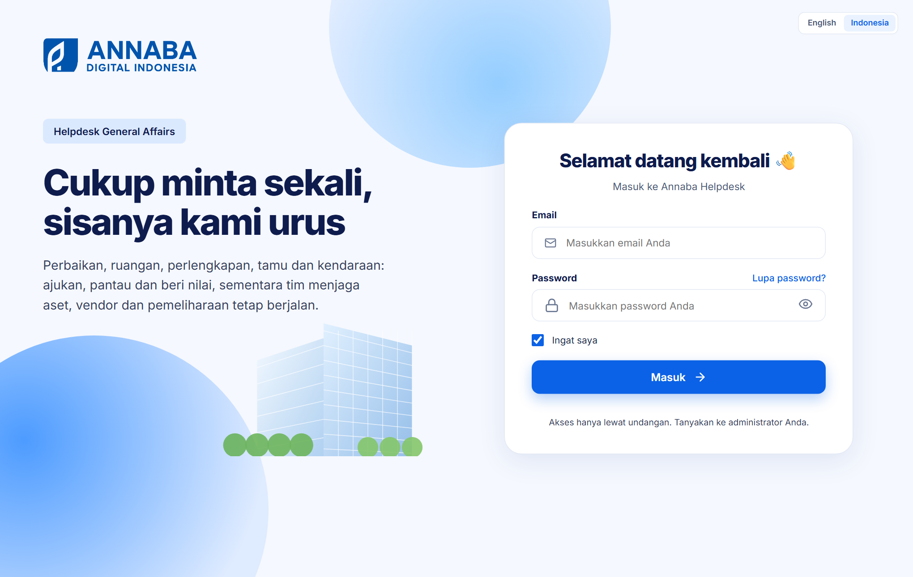

*Halaman masuk. Pilihan bahasa ada di atas formulir.*

Lupa kata sandi: klik **Lupa password?** di halaman masuk. Tautan penggantinya dikirim ke e-mail Anda dan berlaku 30 menit.

### Susunan menu

Menu di sisi kiri mengikuti urutan pekerjaan: meminta bantuan dulu, lalu mengerjakan, lalu menganalisis dan mengatur. Anda hanya melihat menu yang boleh Anda buka.

| Grup menu | Isinya | Siapa yang melihat |
| --- | --- | --- |
| **Beranda** sampai **Persetujuan** | Permintaan baru, Permintaan saya, Basis pengetahuan, Pemesanan, Tamu saya, Surat & paket, Perlengkapan, Persetujuan | Semua |
| **Service desk** | Antrean Tiket, Perintah Kerja, Mode lapangan, Resepsionis | Tim GA dan resepsionis |
| **Aset & vendor** | Aset, Perawatan, Vendor, Inventaris | Tim GA |
| **Analitik** | Operasional, Laporan SLA, Kepuasan, Kepatuhan perawatan, Utilisasi, Laporan Biaya, Anggaran, Ekspor laporan | Tim GA dan manajemen |
| **Pengaturan Helpdesk** | Mulai, Katalog Layanan, Lokasi, Tim, Kalender Kerja, Kebijakan SLA, Aturan Penugasan, Kebijakan Persetujuan, Jenis Aset, Sumber daya yang bisa dipesan, Aturan tamu, Daftar Periksa, Pusat Biaya | GA Manager |
| **Orang & akses** | Pengguna, undangan, peran dan izin, tinjauan akses, log audit, peristiwa keamanan | Administrator dan auditor |
| **Administrasi** | Pengaturan sistem, kebijakan keamanan, e-mail, integrasi, direktori, kanal notifikasi | Administrator |
| **Pribadi** | Profil Saya, Notifikasi, Permintaan Akses, Sesi & Perangkat, Pengaturan, Bantuan | Semua |

Di atas setiap judul halaman tertulis nama grupnya, sehingga Anda selalu tahu sedang berada di modul mana.

### Beranda

Beranda adalah halaman pertama setelah masuk, dan isinya menyesuaikan peran Anda.

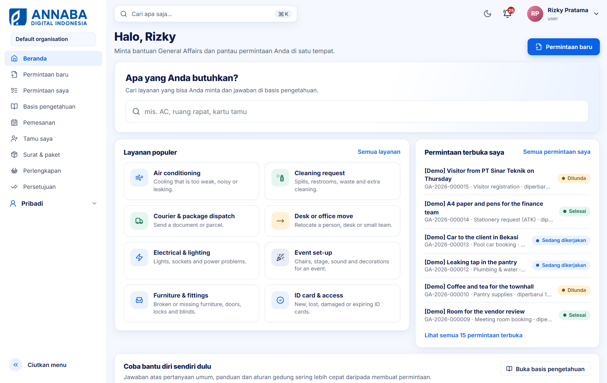

*Beranda seorang karyawan: kotak pencarian layanan, layanan populer, dan permintaan yang masih terbuka. Gambar di panduan ini memakai data contoh.*

- **Karyawan** melihat kotak **Apa yang Anda butuhkan?** untuk mencari layanan atau jawaban di basis pengetahuan, daftar **Layanan populer**, dan **Permintaan terbuka saya**.
- **Tim GA** melihat ringkasan pekerjaan: tiket terbuka, yang mendekati atau melewati SLA, perintah kerja hari ini, dan hal yang perlu perhatian.
- **Mulai** tampil untuk GA Manager selama helpdesk belum selesai disiapkan (lihat bab 10).

### Bagian atas layar

- **Kotak cari** (atau tekan Ctrl+K / ⌘K): ketik nama halaman, nomor tiket, atau nama aset untuk langsung membukanya.
- **Ikon bulan**: beralih antara tampilan terang dan gelap.
- **Lonceng**: notifikasi untuk Anda, misalnya permintaan yang mulai dikerjakan, paket yang tiba, atau tamu yang datang. Angka merah menunjukkan yang belum dibaca.
- **Nama Anda**: membuka profil, **Kunci layar**, dan **Keluar**.

Di ponsel, menu dibuka dengan tombol garis tiga di kiri atas. Di komputer, **Ciutkan menu** di kiri bawah memberi ruang lebih untuk tabel.

### Bahasa, notifikasi, dan keamanan sesi

- Ganti bahasa di **Pribadi → Pengaturan** (Indonesia atau Inggris).
- Atur apa yang diberitahukan kepada Anda di **Pribadi → Notifikasi → Pengaturan**: untuk setiap kejadian, pilih apakah muncul di aplikasi dan apakah dikirim lewat e-mail. Beberapa notifikasi penting, misalnya persetujuan yang menunggu Anda, tidak bisa dimatikan.
- Bila organisasi menawarkannya, notifikasi juga bisa dikirim ke **WhatsApp**, **Slack**, atau **Microsoft Teams** (lihat bab 3).
- Layar terkunci sendiri setelah beberapa menit tidak dipakai. Masukkan kata sandi untuk melanjutkan.
- Untuk tindakan sensitif, misalnya mengubah peran atau menerapkan sinkronisasi direktori, aplikasi meminta kata sandi sekali lagi. Itu normal.
- **Pribadi → Sesi & Perangkat** menampilkan di perangkat mana akun Anda sedang masuk. Cabut sesi yang tidak Anda kenali.

## 3. Untuk semua karyawan

Bab ini berisi semua yang bisa dilakukan setiap karyawan, tanpa izin khusus.

### Membuat permintaan

Gunanya: meminta bantuan GA, misalnya AC rusak, lampu mati, kebersihan, ATK, atau pindah meja, dengan cara yang tercatat dan terpantau.

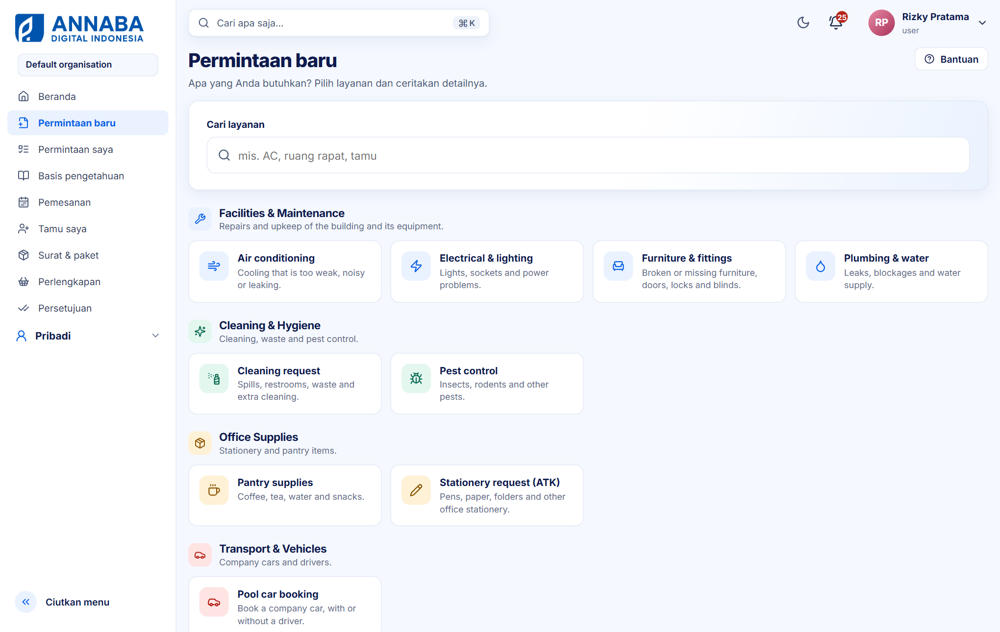

*Permintaan baru: layanan dikelompokkan per kategori. Ketik di kotak cari untuk menemukannya lebih cepat.*

1. Klik **Permintaan baru** di menu atau di Beranda.
2. Pilih layanan yang paling cocok. Tidak yakin? Ketik kata kuncinya di kotak cari, misalnya "AC" atau "kartu tamu".
3. Isi formulirnya: subjek singkat, rincian, dan lokasi. Pertanyaan bertanda bintang wajib diisi.
4. Lampirkan foto bila membantu (foto, PDF, dokumen Office; maksimal 8 MB per berkas).
5. Tekan **Kirim permintaan**. Anda mendapat nomor tiket, misalnya `GA-2026-000123`.

Yang perlu diketahui:

- Sebelum membuat permintaan, coba **Basis pengetahuan**. Pertanyaan umum, panduan, dan aturan gedung sering lebih cepat dijawab di sana.
- Beberapa layanan perlu disetujui dulu, misalnya oleh atasan Anda. Statusnya **Menunggu persetujuan**, dan pekerjaan baru dimulai setelah disetujui.
- Permintaan juga bisa dibuat dengan mengirim e-mail ke alamat helpdesk bila organisasi mengaktifkannya. E-mail itu menjadi tiket dengan nomor yang sama.

### Permintaan saya

Gunanya: melihat semua yang pernah Anda minta dan sampai di mana prosesnya.

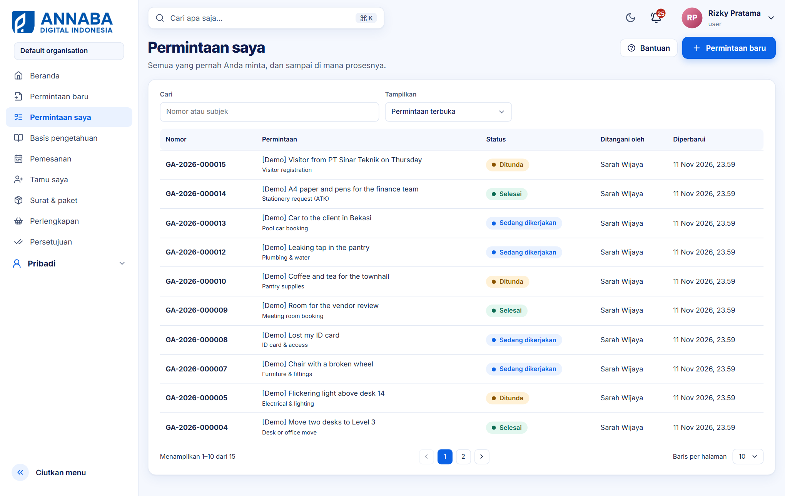

*Permintaan saya: nomor, subjek, status, siapa yang menangani, dan kapan terakhir diperbarui.*

1. Buka **Permintaan saya**. Pilih di **Tampilkan**: **Permintaan terbuka**, **Semua permintaan**, **Ditutup**, atau **Dibatalkan**.
2. Klik nomor atau subjek untuk membuka tiketnya.
3. Di tiket, baca **Aktivitas** untuk melihat apa yang sudah dilakukan, dan balas lewat **Tambah komentar → Kirim komentar** bila tim GA bertanya.

Status yang akan Anda lihat:

| Status | Artinya |
| --- | --- |
| **Diajukan** | Sudah diterima, belum ada yang memegang |
| **Menunggu persetujuan** | Menunggu keputusan pemberi persetujuan |
| **Ditugaskan** | Sudah ada orang atau tim yang memegangnya |
| **Sedang dikerjakan** | Sedang ditangani |
| **Ditunda** | Menunggu sesuatu, misalnya suku cadang; alasannya tertulis di aktivitas |
| **Selesai** | Tim GA menyatakan sudah beres; giliran Anda mengonfirmasi |
| **Ditutup** | Dikonfirmasi oleh Anda, atau ditutup otomatis 3 hari setelah selesai |
| **Dibuka kembali** | Anda menyatakan belum beres, dan tiket kembali ke tim |
| **Ditolak** / **Dibatalkan** | Tidak disetujui, atau ditarik kembali |

**Saat permintaan selesai**, buka tiketnya, lalu pilih:

- **Konfirmasi sudah beres** bila masalahnya memang tuntas. Setelah itu Anda diminta menilai di **Bagaimana hasilnya?** (1–5 bintang dan komentar), lalu tekan **Kirim penilaian**. Penilaian ini membantu GA memperbaiki layanan.
- **Buka kembali** bila belum beres, dengan alasannya. Tiket kembali ke orang yang sama.

Bila Anda tidak memilih apa pun, tiket ditutup otomatis setelah 3 hari.

### Pemesanan ruang, kendaraan, parkir, dan peralatan

Gunanya: memesan ruang rapat, mobil kantor, tempat parkir, atau peralatan bersama tanpa bentrok.

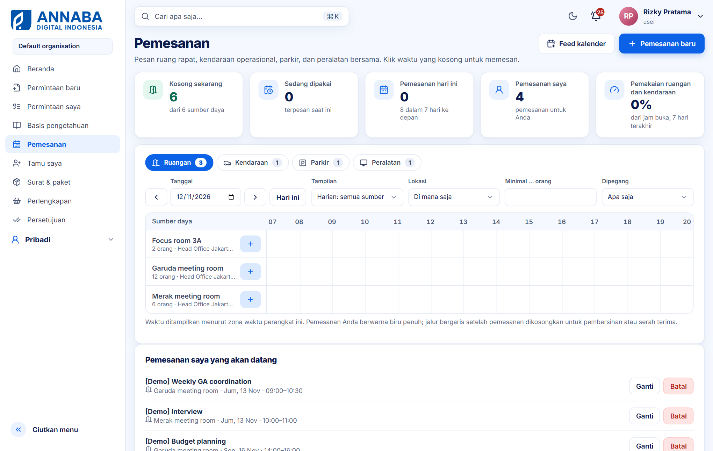

*Pemesanan: sumber daya di kiri, jam di atas. Kotak berwarna adalah pemesanan yang sudah ada.*

1. Buka **Pemesanan**. Atur **Tanggal**, **Lokasi**, jumlah orang (**Minimal … orang**), dan fasilitas yang dibutuhkan (proyektor, panggilan video, dan lain-lain).
2. Klik waktu yang masih kosong pada baris sumber daya yang Anda mau, atau tekan **Pemesanan baru**.
3. Isi judul, jam mulai dan selesai, serta jumlah peserta. Untuk rapat rutin, isi bagian pengulangan (setiap hari, hari kerja, atau setiap minggu).
4. Tekan **Pesan**.

Yang perlu diketahui:

- Sistem menolak pemesanan yang bentrok, di luar jam buka, atau lebih panjang dari batas sumber daya itu. Untuk pemesanan berulang, slot yang bentrok dilewati dan disebutkan.
- Beberapa sumber daya perlu disetujui, misalnya mobil dengan sopir. Statusnya **Menunggu** sampai pengelola memutuskan.
- Ruang yang mewajibkan check-in harus di-check-in dalam beberapa menit setelah mulai. Bila tidak, ruang dilepas untuk orang lain. Anda diingatkan 30 menit sebelumnya.
- Untuk mobil kantor, catat kilometer dan bahan bakar saat mengambil dan mengembalikan kunci. Mengembalikan lebih awal membebaskan sisa waktunya.
- **Feed kalender** memberi tautan pribadi untuk menampilkan pemesanan Anda di Google Calendar atau Outlook. Tautan itu bisa dicabut kapan saja.
- Membatalkan satu pemesanan dari rangkaian berulang bisa untuk satu kejadian saja atau untuk kejadian itu dan seterusnya.

### Tamu saya

Gunanya: memberi tahu resepsionis siapa yang akan menemui Anda, supaya tamu cepat dilayani dan Anda diberi tahu saat ia tiba.

1. Buka **Tamu saya** dan tekan **Daftarkan tamu**.
2. Isi nama tamu, perusahaan, nomor ponsel (opsional), lokasi, keperluan, serta jam datang dan perkiraan selesai.
3. Simpan. Tamu tampil sebagai **Diharapkan datang**.

Saat tamu tiba, resepsionis mencatat check-in dan Anda menerima notifikasi. Status berikutnya: **Di lokasi**, lalu **Sudah pulang**, atau **Tidak datang** bila tamu tidak muncul. Ganti jadwal dengan **Ganti**, atau batalkan dengan **Batal**.

### Surat & paket

Gunanya: tahu bila ada surat atau paket untuk Anda di resepsionis, dan memantau surat yang dikirim atas nama Anda.

Buka **Surat & paket**. Paket yang **Menunggu di resepsionis** bisa diambil; Anda diberi tahu saat dicatat dan diingatkan bila sudah lebih dari dua hari. Surat keluar tampil sebagai **Akan dikirim**, lalu **Terkirim** dengan nama kurir dan nomor resi.

### Perlengkapan (ATK dan barang stok)

Gunanya: meminta ATK, kebutuhan pantri, atau barang stok lain, lalu tahu kapan bisa diambil.

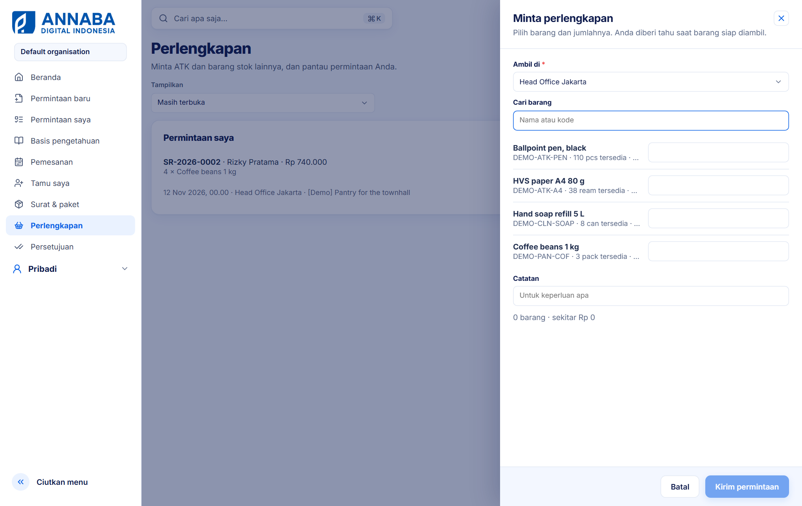

*Minta perlengkapan: pilih tempat pengambilan, lalu isi jumlah untuk setiap barang. Ketersediaan di tempat itu tampil di bawah nama barang.*

1. Buka **Perlengkapan** dan tekan **Minta perlengkapan**.
2. Pilih **Ambil di**: gudang atau tempat Anda akan mengambil barangnya.
3. Cari barang, lalu isi jumlah di kotak di sebelah setiap barang yang Anda butuhkan.
4. Tulis **Catatan** untuk keperluan apa, lalu tekan **Kirim permintaan**.

Yang perlu diketahui:

- Permintaan di atas nilai tertentu harus disetujui atasan Anda dulu (**Menunggu persetujuan**). Bila Anda tidak punya atasan di sistem, petugas perlengkapan yang memutuskan.
- Status setelah itu: **Akan diserahkan**, lalu **Diserahkan**. Bila stok kurang, sebagian diserahkan dulu (**Diserahkan sebagian**) dan sisanya menyusul.
- Anda diberi tahu setiap kali ada barang yang siap diambil.
- Permintaan bisa dibatalkan selama belum ada barang yang diserahkan.

### Notifikasi di WhatsApp, Slack, atau Teams

Gunanya: menerima pemberitahuan helpdesk di aplikasi yang Anda pakai sehari-hari.

Bila organisasi menawarkannya, bagian **Kanal lain** muncul di **Pribadi → Notifikasi → Pengaturan**:

1. **WhatsApp**: isi nomor ponsel (boleh 0812… atau +62…), tekan **Kirim kode**, lalu masukkan kode 6 angka yang Anda terima di WhatsApp dan tekan **Konfirmasi**.
2. **Slack**: tekan **Hubungkan dengan e-mail saya**. Akun Slack Anda dicari dengan alamat e-mail kantor.
3. **Microsoft Teams**: di Teams, tambahkan template Workflows "Post to a chat when a webhook request is received", salin URL-nya ke **URL Workflows Teams**, lalu tekan **Hubungkan**.

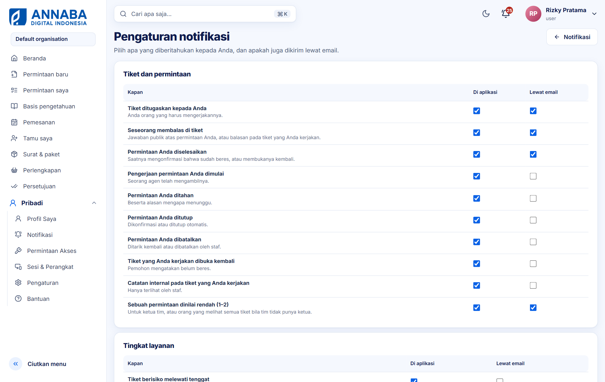

*Pengaturan notifikasi: untuk setiap kejadian, pilih apakah muncul di aplikasi dan lewat e-mail. Kanal lain tampil di atasnya bila ditawarkan.*

Kanal menerima apa yang juga Anda terima lewat e-mail. Centang **Sebagai ganti e-mail** bila Anda tidak lagi mau e-mailnya; bila kanal itu gagal terkirim, e-mailnya tetap dikirim. Pakai **Kirim pesan uji** untuk mencoba, dan **Putuskan** untuk berhenti.

## 4. Untuk atasan dan pemberi persetujuan

Bab ini untuk Anda yang diminta menyetujui permintaan bawahan atau permintaan yang membutuhkan izin.

### Persetujuan

Gunanya: memutuskan permintaan yang tidak boleh dikerjakan sebelum disetujui.

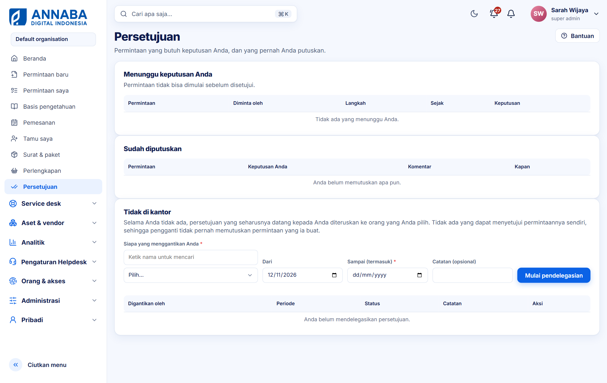

*Persetujuan: yang menunggu keputusan Anda di atas, riwayat keputusan di bawah, dan pendelegasian saat Anda tidak di kantor.*

1. Buka **Persetujuan**. Bagian **Menunggu keputusan Anda** berisi permintaan, siapa yang meminta, langkah persetujuannya, dan sejak kapan menunggu.
2. Buka permintaannya bila perlu, lalu tekan **Setujui** atau **Tolak**. Penolakan wajib diberi alasan, yang akan dibaca peminta.
3. Keputusan Anda tercatat di **Sudah diputuskan**.

Yang perlu diketahui:

- Permintaan bisa melalui beberapa langkah, misalnya atasan lalu manajer GA. Setelah bagian Anda selesai, tombolnya hilang dan permintaan menunggu langkah berikutnya.
- Permintaan perlengkapan bawahan Anda juga muncul di **Perlengkapan**, bagian **Menunggu persetujuan Anda**.
- Anda diberi tahu lewat notifikasi setiap ada yang menunggu. Notifikasi ini tidak bisa dimatikan, karena pekerjaan orang lain menunggu keputusan Anda.

### Saat tidak di kantor

Di bagian **Tidak di kantor**, pilih **Siapa yang menggantikan Anda**, isi tanggal **Dari** dan **Sampai (termasuk)**, lalu tekan **Mulai pendelegasian**. Selama periode itu, persetujuan untuk Anda diteruskan ke orang tersebut. Tidak ada yang dapat menyetujui permintaannya sendiri.

## 5. Untuk tim GA: tiket dan perintah kerja

Bab ini untuk GA Agent, GA Supervisor, dan GA Manager yang mengerjakan permintaan.

### Antrean Tiket

Gunanya: melihat semua permintaan yang harus ditangani tim Anda dan memastikan tidak ada yang melewati batas waktu.

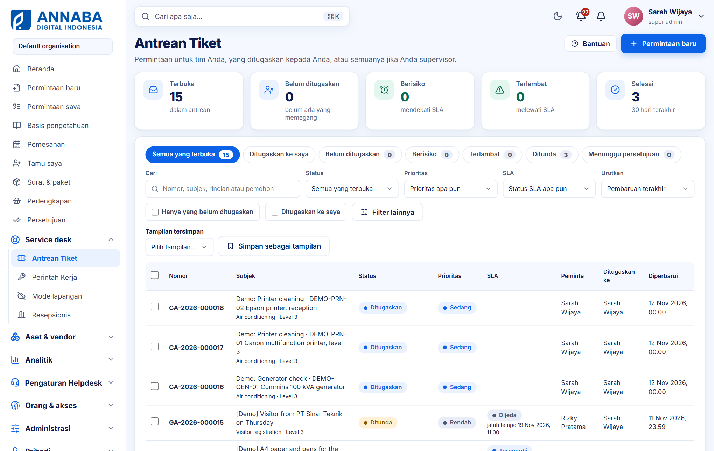

*Antrean Tiket: angka ringkasan di atas, tab cepat, filter, lalu daftar tiket dengan status, prioritas, dan SLA.*

- Angka di atas menunjukkan tiket **Terbuka**, **Belum ditugaskan**, **Berisiko** (mendekati batas SLA), **Terlambat** (melewati SLA), dan **Selesai** 30 hari terakhir.
- Tab cepat menyaring dengan satu klik: **Ditugaskan ke saya**, **Belum ditugaskan**, **Berisiko**, **Terlambat**, **Ditunda**, **Menunggu persetujuan**.
- Pakai **Cari** dan filter **Status**, **Prioritas**, **SLA**, serta **Filter lainnya**. Simpan kombinasi yang sering dipakai dengan **Simpan sebagai tampilan**.
- Centang beberapa tiket untuk menugaskan atau mengubahnya sekaligus.

GA Agent melihat tiket timnya dan yang ditugaskan kepadanya. GA Supervisor ke atas melihat semua tiket.

### Menangani sebuah tiket

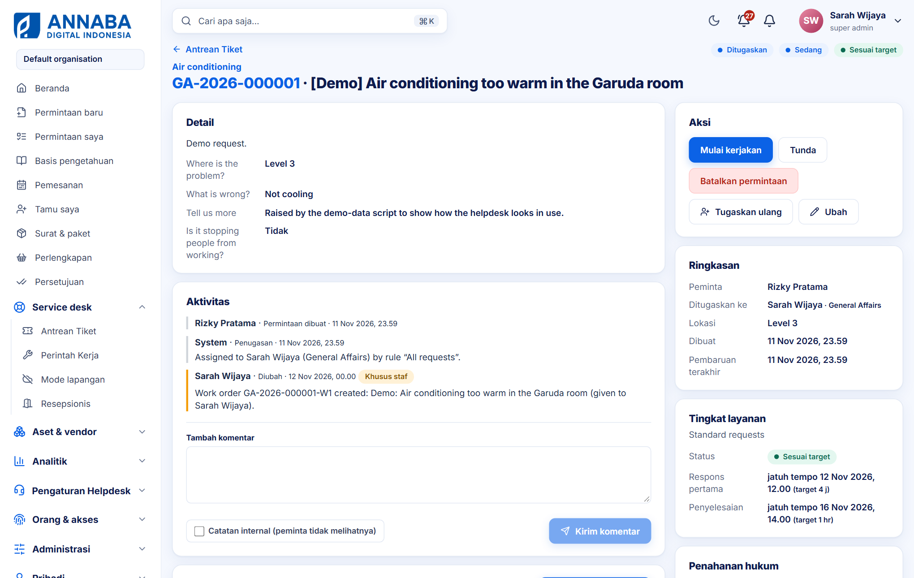

*Detail tiket: jawaban formulir dan aktivitas di tengah, tombol aksi dan ringkasan di kanan, perintah kerja di bawah.*

1. Buka tiketnya dan baca **Detail**: jawaban formulir dan lampiran dari peminta.
2. Tekan **Mulai kerjakan**. SLA mencatat kapan tiket mulai ditangani.
3. Komunikasikan lewat **Tambah komentar**. Centang **Catatan internal (peminta tidak melihatnya)** untuk catatan antartim.
4. Bila pekerjaan menunggu sesuatu, tekan **Tunda** dan tulis alasannya. Selama ditunda, waktu SLA berhenti.
5. Bila perlu kunjungan lapangan atau vendor, buat **Perintah kerja baru** (lihat di bawah).
6. Setelah beres, tekan **Selesaikan**, pilih cara penyelesaiannya, dan tulis apa yang dilakukan. Peminta diminta mengonfirmasi.

Yang perlu diketahui:

- **Tugaskan ulang** memindahkan tiket ke orang atau tim lain. **Ubah** mengganti kategori, prioritas, atau lokasi.
- SLA dihitung pada jam kerja organisasi (**Kalender Kerja**). Lencana SLA berubah dari **Sesuai target** menjadi berisiko dan akhirnya terlambat, dan supervisor diberi tahu sebelum tiket terlambat.
- **Pasang penahanan hukum** menjaga tiket dan berkasnya dari penghapusan otomatis, misalnya bila terkait perkara.
- Tiket yang dibuat oleh rencana perawatan berkala ditandai sebagai pekerjaan terencana.

### Perintah kerja

Gunanya: memecah tiket menjadi pekerjaan lapangan yang jelas, dengan instruksi, daftar periksa, foto, waktu, dan biaya. Pekerjaan itu bisa dikerjakan teknisi internal atau vendor.

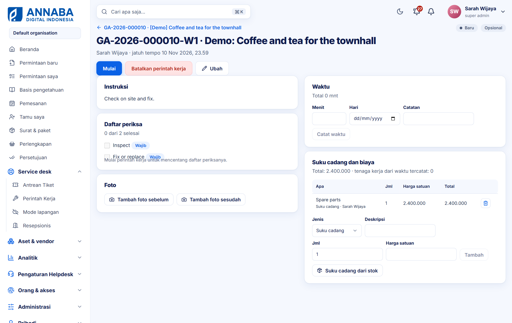

*Perintah kerja: instruksi dan daftar periksa, foto sebelum dan sesudah, waktu yang dicatat, serta suku cadang dan biaya.*

1. **Membuat** (supervisor ke atas): dari tiket, tekan **Perintah kerja baru**, isi judul dan instruksi, pilih teknisi atau vendor, tenggat, dan daftar periksa (bisa dari template **Daftar Periksa**). Tandai apakah perintah kerja ini wajib selesai sebelum tiket bisa diselesaikan.
2. **Mengerjakan**: buka **Service desk → Perintah Kerja**, pilih pekerjaan Anda, lalu tekan **Mulai**.
3. Centang setiap baris **Daftar periksa** yang sudah dikerjakan. Baris bertanda **Wajib** harus dicentang sebelum bisa diselesaikan.
4. Tambahkan bukti dengan **Tambah foto sebelum** dan **Tambah foto sesudah**.
5. Catat waktu kerja: isi **Menit**, **Hari**, dan **Catatan**, lalu tekan **Catat waktu**.
6. Catat biaya di **Suku cadang dan biaya**: pilih **Jenis** (suku cadang, tenaga kerja, layanan, tagihan vendor, lainnya), isi deskripsi, jumlah, dan harga, lalu tekan **Tambah**. Untuk barang dari gudang, pakai **Suku cadang dari stok**: stok langsung berkurang dan biayanya memakai harga barang. Menghapus barisnya mengembalikan stok.
7. Tekan **Selesaikan** dan tulis apa yang dikerjakan. Bila masih ada yang kurang, aplikasi menyebutkannya di **Sebelum dapat diselesaikan**.

Yang perlu diketahui:

- **Tunda** dan **Lanjutkan** dipakai bila pekerjaan terhenti, misalnya menunggu suku cadang.
- Bila semua perintah kerja wajib selesai dan tiketnya diatur begitu, tiket ikut diselesaikan otomatis.
- Vendor yang diundang ke portal vendor hanya melihat perintah kerja perusahaannya, dan mengerjakannya dengan langkah yang sama.

### Mode lapangan (tanpa sinyal)

Gunanya: tetap bisa bekerja di ruang mesin, basement, atau lift yang tidak ada sinyal.

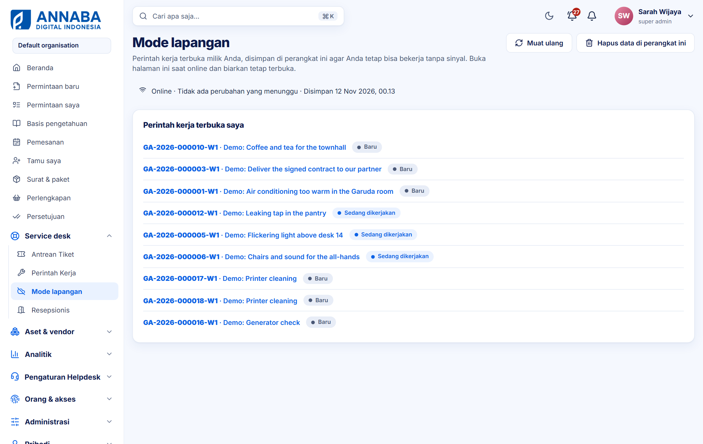

*Mode lapangan: status koneksi dan jumlah perubahan yang menunggu di atas, perintah kerja terbuka Anda di bawahnya.*

1. **Selagi masih ada sinyal**, buka **Service desk → Mode lapangan**. Perintah kerja terbuka milik Anda disimpan di perangkat. Biarkan halaman tetap terbuka.
2. Di lokasi, pilih perintah kerjanya, lalu tekan **Mulai**, centang daftar periksa, catat waktu, atau tambahkan foto. Semua langsung tampil dan disimpan di perangkat. Baris status menunjukkan **Offline** dan berapa perubahan yang menunggu.
3. Begitu sinyal kembali, perubahan dikirim otomatis. Bisa juga dengan **Sinkronkan sekarang**. Bila berhasil, tertulis **Semua perubahan sudah tersinkron**.

Yang perlu diketahui:

- Jangan memuat ulang halaman saat offline. Aplikasi tidak menyimpan halamannya, jadi yang tampil hanya halaman offline.
- Bila server menolak sebuah perubahan, misalnya karena perintah kerja sudah diubah orang lain, perubahan itu tampil di **Perubahan yang ditolak server** dengan alasannya. Pilih **Coba lagi** atau **Buang**; tidak ada yang tertimpa diam-diam.
- Perubahan yang sama tidak pernah tercatat dua kali, walaupun terkirim ulang.
- Data di perangkat hanya berisi perintah kerja Anda sendiri, kedaluwarsa setelah 72 jam, dan terhapus saat Anda keluar. Pakai **Hapus data di perangkat ini** bila meminjam perangkat orang lain.

## 6. Aset, perawatan, dan vendor

### Aset

Gunanya: tahu apa yang dimiliki organisasi, di mana letaknya, siapa pemegangnya, kapan garansinya habis, dan riwayat perbaikannya.

*Aset: angka ringkasan (masih beroperasi, sedang diperbaiki, garansi akan habis, perawatan jatuh tempo, nilai pembelian) di atas daftar aset.*

- **Aset baru** mencatat satu aset: label, nama, jenis, status, lokasi, pemegang, tanggal dan harga beli, serta akhir garansi. Kolom tambahan mengikuti **Jenis Aset**.
- **Impor** memasukkan banyak aset sekaligus dari CSV. **Ekspor CSV** mengunduh daftarnya.
- **Label** mencetak label QR. Memindai QR dengan kamera ponsel membuka halaman aset itu, sehingga orang bisa langsung melaporkan kerusakan atas aset tersebut.
- Halaman setiap aset menunjukkan tiket, perintah kerja, biaya, dan rencana perawatannya.

### Perawatan berkala

Gunanya: membuat pekerjaan rutin, misalnya servis AC setiap 3 bulan, otomatis muncul sebelum jatuh tempo.

1. Buka **Aset & vendor → Perawatan** dan tekan **Rencana baru**.
2. Pilih aset atau lokasinya, apa yang dirawat, seberapa sering, siapa yang mengerjakan (tim atau vendor), dan daftar periksanya.
3. Sistem membuat tiket dan perintah kerja beberapa hari sebelum tanggalnya.

**Kepatuhan** menunjukkan berapa kunjungan yang tepat waktu, terlambat, atau terlewat per rencana, tim, vendor, atau lokasi.

### Vendor

**Aset & vendor → Vendor** menyimpan data vendor: kontak, layanan, lokasi yang dilayani, kontrak dan dokumennya (beserta pengingat masa berlaku), serta kinerjanya (jumlah pekerjaan, ketepatan waktu, biaya, dan penilaian). Vendor yang bermasalah bisa diblokir agar tidak bisa diberi pekerjaan baru. Orang dari vendor dapat diundang ke portal vendor dan ditautkan ke perusahaannya.

## 7. Resepsionis: tamu dan surat

### Resepsionis

Gunanya: tahu siapa yang dijadwalkan datang hari ini dan siapa yang sedang berada di gedung.

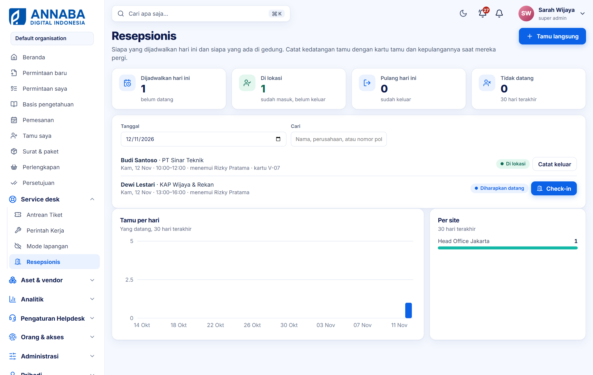

*Resepsionis: tamu yang dijadwalkan, yang sedang di lokasi, dan yang sudah pulang hari ini.*

1. Saat tamu datang, cari namanya lalu tekan **Check-in**. Isi nomor kartu tamu dan empat angka terakhir identitasnya, lalu konfirmasi bahwa tamu sudah membaca aturan gedung. Tuan rumah langsung diberi tahu.
2. Tamu yang datang tanpa didaftarkan dicatat lewat **Tamu langsung** (**Daftarkan tamu langsung**).
3. Saat tamu pergi, tekan **Catat keluar**. Kartu tamu bisa dipakai lagi.

Yang perlu diketahui:

- Tamu yang namanya ada di daftar blokir ditandai. Resepsionis memutuskan sesuai prosedur gedung.
- Tamu yang tidak datang sampai jamnya lewat ditandai **Tidak datang**. Data tamu dianonimkan otomatis setelah masa simpan yang diatur di **Aturan tamu**.

### Ruang surat

Buka **Surat & paket** (resepsionis melihatnya sebagai **Ruang surat**).

- **Masuk**: catat surat atau paket yang tiba (jenis, untuk siapa, pengirim, kurir, resi). Penerima langsung diberi tahu dan diingatkan setelah dua hari. Saat diambil, tekan **Sudah diambil** dan isi siapa yang mengambil.
- **Keluar**: catat surat yang akan dikirim, lalu tandai **Terkirim** dengan kurir dan nomor resinya.

## 8. Inventaris dan perlengkapan

### Inventaris

Gunanya: tahu berapa banyak setiap barang di setiap tempat, apa yang hampir habis, dan setiap pergerakannya.

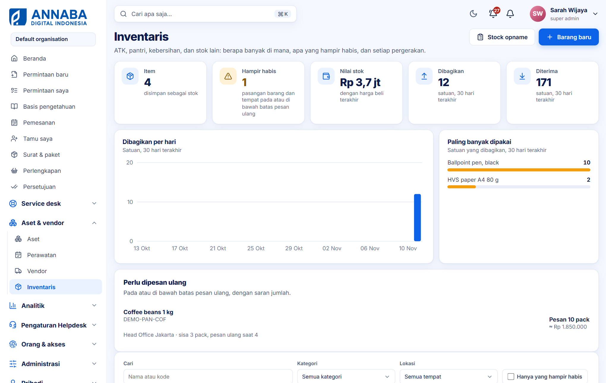

*Inventaris: jumlah barang, yang hampir habis, nilai stok, dan barang yang dibagikan, lalu daftar barang per tempat.*

1. **Barang baru**: isi kode (SKU), nama, kategori, satuan, batas pesan ulang, jumlah pesan biasa, dan harga.
2. Setiap perubahan stok lewat **Gerakkan stok**: menerima kiriman (dengan pemasok atau nomor faktur, dan harganya), membagikan (untuk siapa), koreksi (dengan alasan), atau memindahkan ke tempat lain.
3. **Perlu dipesan ulang** mendaftar barang yang sudah di atau di bawah batas, beserta saran jumlah dan perkiraan biayanya.
4. **Stock opname**: pilih tempat, tekan **Mulai hitung**, isi jumlah yang ada di rak, lalu tutup hitungannya. Selisihnya dicatat otomatis.

Yang perlu diketahui:

- Jumlah stok tidak pernah diketik langsung. Setiap angka berasal dari pergerakan yang tercatat, dan stok tidak bisa menjadi minus.
- Pemegang stok diberi tahu sekali saat sebuah barang turun ke batas pesan ulang di suatu tempat.

### Meja perlengkapan

Petugas perlengkapan (GA Supervisor ke atas) melihat **Semua permintaan** di halaman **Perlengkapan**.

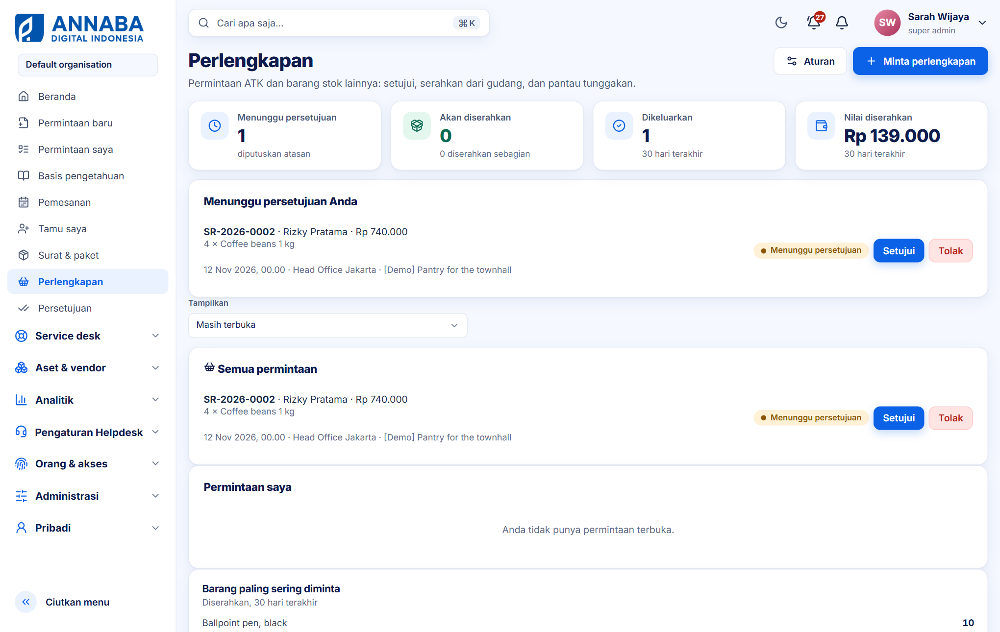

*Meja perlengkapan: ringkasan permintaan dan semua permintaan yang perlu diserahkan.*

1. Tekan **Serahkan** pada permintaan. Jumlah sudah terisi dengan yang diminta dan tersedia.
2. Ubah jumlahnya bila stok kurang. Yang belum diserahkan menjadi tunggakan (back-order).
3. Konfirmasi. Stok berkurang, dan peminta diberi tahu bahwa barangnya siap diambil.
4. Bila sisanya tidak akan diserahkan, tekan **Tutup** dan tulis alasannya.

GA Manager mengatur di **Aturan** nilai mulai berapa sebuah permintaan perlu disetujui atasan, dan tempat pengambilan bawaannya.

## 9. Analitik dan laporan

Semua laporan menghormati hak akses. Agent melihat angka timnya, supervisor ke atas melihat semuanya.

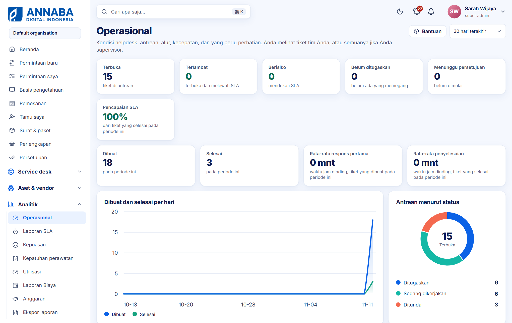

*Operasional: kondisi helpdesk hari ini dan tren dalam periode yang dipilih.*

| Laporan | Isinya |
| --- | --- |
| **Operasional** | Tiket terbuka, terlambat, berisiko, belum ditugaskan; alur masuk dan selesai; umur tiket; beban per orang |
| **Laporan SLA** | Persentase tepat waktu per prioritas, tim, dan layanan; daftar tiket yang terlambat |
| **Kepuasan** | Nilai rata-rata, persentase puas, komentar, dan trennya per minggu atau bulan |
| **Kepatuhan perawatan** | Kunjungan perawatan yang tepat waktu, terlambat, dan terlewat |
| **Utilisasi** | Pemakaian ruang dan kendaraan dibanding jam buka; tidak hadir; kilometer |
| **Laporan Biaya** | Biaya per bulan, lokasi, pusat biaya, kategori, vendor, atau aset |
| **Anggaran** | Anggaran per lokasi atau pusat biaya, dan berapa yang sudah terpakai |

Pilih periode (7 hari sampai 12 bulan) di bagian atas setiap laporan.

### Ekspor dan laporan terjadwal

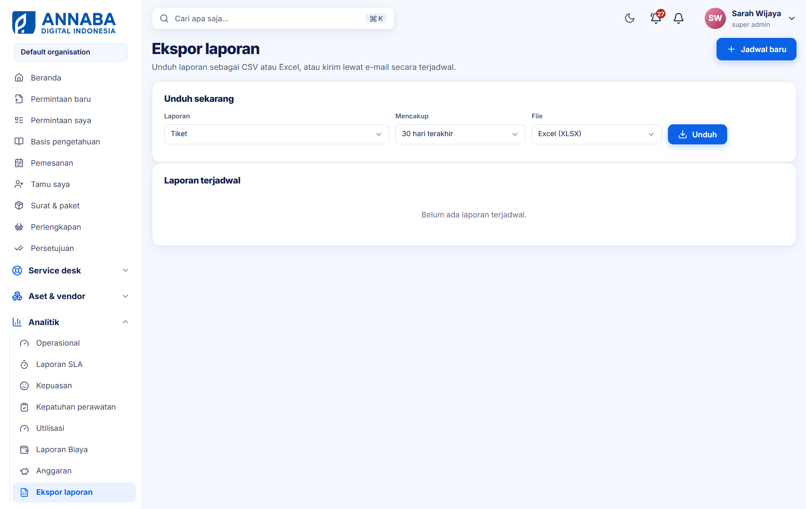

*Ekspor laporan: unduh sekarang, atau kirim lewat e-mail secara terjadwal.*

1. **Unduh sekarang**: pilih **Laporan**, periode (**Mencakup**), dan jenis **File** (Excel atau CSV), lalu tekan **Unduh**.
2. **Jadwal baru**: beri nama, pilih laporan, file, seberapa sering (setiap hari, minggu, atau bulan), jamnya, dan alamat e-mail penerima. Simpan.
3. **Kirim sekarang** mengirim laporan terjadwal saat itu juga, tanpa mengubah jadwalnya.

Setiap penerima menerima laporan sesuai yang boleh ia lihat sendiri. Penerima yang kehilangan akses dilewati dan tercatat di hasil pengiriman terakhir.

## 10. Untuk GA Manager: pengaturan helpdesk

Semua pengaturan ada di grup **Pengaturan Helpdesk**.

### Mulai

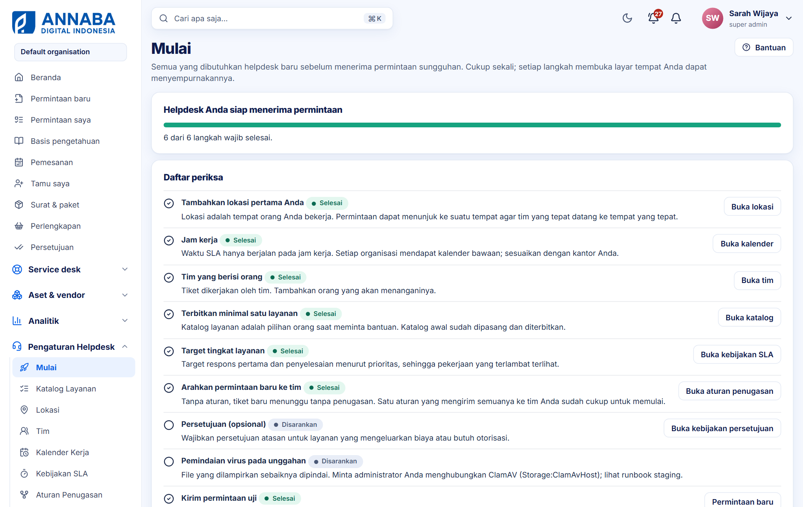

*Mulai: daftar periksa penyiapan. Setiap langkah membuka layar tempat mengaturnya.*

**Mulai** menunjukkan apa yang masih perlu disiapkan sebelum helpdesk menerima permintaan sungguhan: lokasi, jam kerja, tim, layanan yang terbit, SLA, dan aturan penugasan. Organisasi baru mendapat katalog awal yang sudah terisi dan terbit.

### Yang diatur di sini

| Menu | Yang diatur |
| --- | --- |
| **Katalog Layanan** | Kategori dan layanan yang bisa diminta, formulir setiap layanan (pertanyaan, pilihan, wajib atau tidak), tim pemiliknya, dan terbit atau tidak |
| **Lokasi** | Situs, gedung, lantai, dan ruangan, beserta zona waktunya |
| **Tim** | Anggota tim dan ketuanya |
| **Kalender Kerja** | Jam kerja dan hari libur, dasar perhitungan SLA |
| **Kebijakan SLA** | Target waktu respons dan penyelesaian per prioritas atau layanan |
| **Aturan Penugasan** | Ke tim dan orang siapa permintaan baru diarahkan, berdasarkan layanan, lokasi, atau kata kunci |
| **Kebijakan Persetujuan** | Layanan mana yang perlu disetujui dan oleh siapa (atasan langsung, orang tertentu, beberapa langkah) |
| **Jenis Aset** | Jenis aset dan kolom tambahannya |
| **Sumber daya yang bisa dipesan** | Ruang, kendaraan, parkir, dan peralatan: kapasitas, fasilitas, jam buka, batas durasi, jeda antarpemesanan, wajib check-in, perlu persetujuan, siapa yang boleh memesan; dokumen kendaraan dan SIM sopir |
| **Aturan tamu** | Teks persetujuan aturan gedung, daftar blokir, masa simpan data tamu |
| **Daftar Periksa** | Template daftar periksa untuk perintah kerja dan perawatan |
| **Pusat Biaya** | Pusat biaya untuk laporan biaya dan anggaran |

## 11. Untuk administrator

### Pengguna dan peran

- **Orang & akses → Pengguna → Undangan**: undang orang baru dengan peran awalnya, satu per satu atau lewat impor CSV. Undangan berlaku 7 hari dan bisa dikirim ulang.
- **Semua Pengguna**: ubah data, peran, dan atasan langsung seseorang; tangguhkan, buka kunci, atau atur ulang MFA-nya. Atasan langsung dipakai untuk persetujuan dan permintaan perlengkapan.
- **Peran & Izin** dan **Matriks Akses**: peran bawaan sudah mengikuti tugas di bab 1. Anda hanya bisa memberikan peran yang izinnya juga Anda miliki.
- **Tinjauan Akses**: secara berkala minta pemilik memeriksa ulang siapa memegang peran apa.
- **Log Audit** dan **Peristiwa Keamanan**: catatan permanen siapa melakukan apa, dan kejadian keamanan seperti percobaan masuk yang gagal.

### Direktori perusahaan

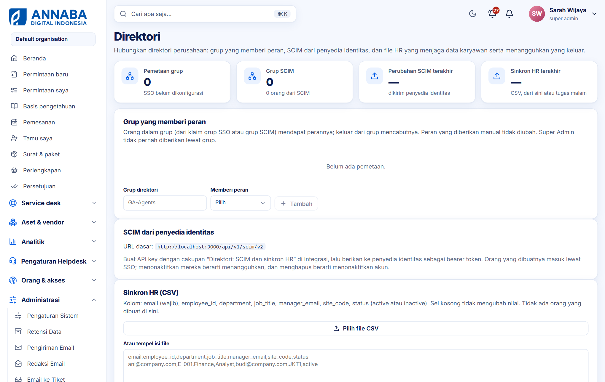

*Direktori: grup yang memberi peran, alamat SCIM, dan sinkronisasi HR lewat CSV.*

- **Grup yang memberi peran**: hubungkan grup dari SSO atau SCIM dengan peran. Contohnya, grup "GA-Agents" memberi peran GA Agent. Orang yang masuk grup mendapat perannya, dan yang keluar kehilangan peran itu. Super Admin tidak pernah diberikan lewat grup.
- **SCIM**: penyedia identitas (misalnya Microsoft Entra ID atau Okta) bisa membuat, mengubah, dan menonaktifkan pengguna otomatis. Buat API key dengan cakupan "Direktori: SCIM dan sinkron HR" di **Integrasi**, lalu berikan URL dasar dan key itu ke penyedia identitas.
- **Sinkron HR (CSV)**: unggah file HR untuk memperbarui ID karyawan, departemen, jabatan, atasan, dan lokasi kerja. Karyawan yang berstatus *inactive* ditangguhkan. Pilih atau tempel file CSV, tekan **Pratinjau**, periksa hasilnya, lalu tekan **Terapkan**. Tidak ada orang yang dibuat lewat CSV.

### Kanal notifikasi dan integrasi

- **Administrasi → Kanal notifikasi**: tawarkan WhatsApp (Meta Cloud API, dengan template yang sudah disetujui), Slack (bot token), atau Microsoft Teams. Kredensial disimpan terenkripsi dan tidak pernah ditampilkan lagi. **Pengiriman terbaru** menunjukkan pesan yang terkirim, dicoba ulang, atau gagal lalu dikirim lewat e-mail.
- **Integrasi**: API key untuk sistem lain dan webhook untuk memberi tahu sistem lain saat ada kejadian.
- **Email ke Tiket**: alamat e-mail yang mengubah e-mail masuk menjadi tiket.
- **Pengiriman Email** dan **Redaksi Email**: status e-mail keluar, dan kalimat pembuka serta penutup e-mail organisasi.
- **Retensi Data**: berapa lama tiket, berkas, dan data tamu disimpan sebelum dihapus atau dianonimkan.

## 12. Alur proses dari ujung ke ujung

Bab ini menunjukkan bagaimana pekerjaan tiap peran saling bersambung.

### Alur sebuah permintaan

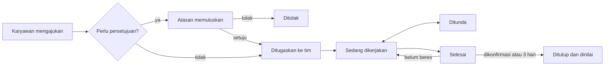

Peminta diberi tahu pada setiap langkah. Waktu SLA berjalan pada jam kerja dan berhenti selama tiket ditunda.

### Alur perintah kerja

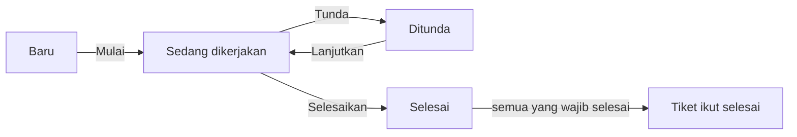

Perintah kerja hanya bisa diselesaikan bila daftar periksa wajib tercentang dan foto sesudah ada (bila diminta).

### Alur permintaan perlengkapan

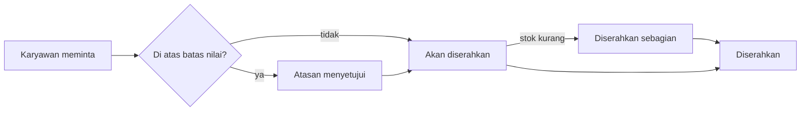

Setiap barang yang diserahkan mengurangi stok di tempat pengambilannya, dan peminta diberi tahu barangnya siap diambil.

### Kedatangan tamu

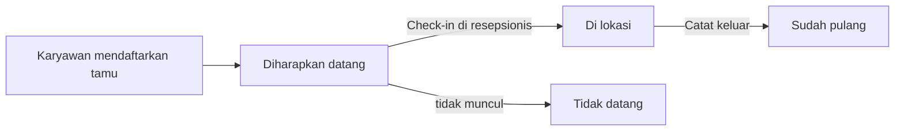

Tuan rumah diberi tahu saat tamunya check-in. Tamu langsung (tanpa didaftarkan) dicatat resepsionis dan masuk ke alur yang sama.

### Kegiatan rutin tim GA

| Kapan | Siapa | Yang dikerjakan |
| --- | --- | --- |
| Setiap pagi | GA Supervisor | Membuka **Antrean Tiket**: menugaskan yang belum ditugaskan, memeriksa yang berisiko dan terlambat |
| Setiap hari | GA Agent | Mengerjakan tiket dan perintah kerja, mencatat waktu dan biaya, memakai mode lapangan bila perlu |
| Setiap hari | Resepsionis | Mencatat tamu dan surat, memastikan semua tamu sudah check-out |
| Setiap hari | Petugas perlengkapan | Menyerahkan permintaan perlengkapan yang siap |
| Setiap minggu | GA Manager | Memeriksa **Perlu dipesan ulang**, kepatuhan perawatan, dan penilaian rendah |
| Setiap bulan | GA Manager | Melihat Laporan SLA, Laporan Biaya terhadap anggaran, utilisasi ruang, dan melakukan stock opname |

## 13. Pertanyaan umum dan istilah

### Pertanyaan yang sering muncul

| Pertanyaan | Jawabannya |
| --- | --- |
| Saya tidak melihat menu yang disebut di panduan ini. | Menu mengikuti peran. Minta administrator memeriksa peran Anda, atau ajukan lewat **Pribadi → Permintaan Akses**. |
| Permintaan saya belum dikerjakan. | Lihat statusnya di **Permintaan saya**. **Menunggu persetujuan** berarti belum disetujui; **Ditunda** menyebut alasannya di aktivitas. |
| Tiket saya ditutup padahal belum beres. | Tiket selesai ditutup otomatis setelah 3 hari tanpa jawaban. Buat permintaan baru dan sebutkan nomor tiket yang lama. |
| Pemesanan saya hilang. | Ruang yang mewajibkan check-in dilepas bila tidak di-check-in tepat waktu. Lihat notifikasi Anda. |
| Pemesanan saya ditolak karena bentrok. | Waktu itu sudah dipesan, atau ada jeda antarpemesanan. Pilih waktu atau ruang lain yang masih kosong. |
| Permintaan perlengkapan saya lama sekali. | Bila statusnya **Menunggu persetujuan**, atasan Anda belum memutuskan. Bila **Diserahkan sebagian**, sisanya menunggu stok. |
| Saya tidak menerima e-mail undangan atau notifikasi. | Periksa folder spam. Administrator bisa memeriksa **Pengiriman Email** dan mengirim ulang undangan. |
| Mengapa saya diminta kata sandi lagi? | Tindakan sensitif meminta konfirmasi ulang bila sudah beberapa menit sejak konfirmasi terakhir. |
| Kode WhatsApp tidak datang. | Pastikan nomornya benar dan aktif di WhatsApp, lalu tekan **Kirim kode baru** setelah satu menit. |
| Mode lapangan menampilkan halaman offline. | Halaman dimuat ulang saat tidak ada sinyal. Buka lagi saat online; perubahan yang sudah tersimpan di perangkat tetap ada. |
| Ponsel saya hilang dan MFA ada di sana. | Masuk dengan kode pemulihan yang Anda simpan, atau minta administrator mengatur ulang MFA Anda. |

### Daftar istilah

| Istilah | Artinya |
| --- | --- |
| Tiket / permintaan | Satu kebutuhan yang diajukan ke GA, dengan nomor seperti `GA-2026-000123` |
| Layanan | Jenis permintaan di katalog, misalnya "Air conditioning" atau "Stationery request (ATK)" |
| SLA | Target waktu untuk mulai menangani dan menyelesaikan tiket, dihitung pada jam kerja |
| Perintah kerja | Pekerjaan lapangan dari sebuah tiket, untuk teknisi internal atau vendor |
| Daftar periksa | Langkah-langkah dalam perintah kerja yang dicentang satu per satu |
| Perawatan berkala | Pekerjaan rutin yang dibuat otomatis menurut jadwal |
| Sumber daya | Sesuatu yang bisa dipesan: ruang, kendaraan, parkir, atau peralatan |
| Check-in | Menandai bahwa ruang benar-benar dipakai, atau bahwa tamu sudah tiba |
| Stock opname | Menghitung stok fisik dan mencatat selisihnya |
| Back-order | Bagian permintaan perlengkapan yang belum bisa diserahkan karena stok kurang |
| Pusat biaya | Unit yang menanggung biaya, untuk laporan dan anggaran |
| MFA | Verifikasi dua langkah: kata sandi ditambah kode dari aplikasi autentikator |
| SSO | Masuk dengan akun kantor dari penyedia identitas organisasi |
| SCIM | Cara penyedia identitas membuat dan menonaktifkan pengguna di helpdesk secara otomatis |
| Log audit | Catatan permanen tentang siapa melakukan apa di sistem |

### Butuh bantuan

Setiap halaman punya tombol **Bantuan** yang menjelaskan halaman itu. Untuk masalah akun dan akses, hubungi administrator. Untuk permintaan, booking, tamu, dan perlengkapan, hubungi tim General Affairs.
